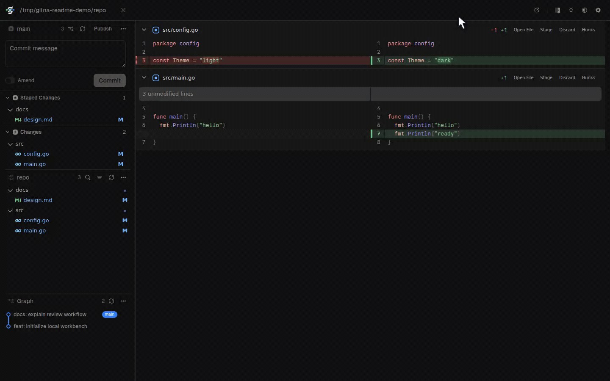

<p align="center">
  <picture>
    <source media="(prefers-color-scheme: dark)" srcset="web/public/gitna-logo-dark.png">
    <source media="(prefers-color-scheme: light)" srcset="web/public/gitna-logo-light.png">
    
  </picture>
</p>

<h1 align="center">Gitna</h1>

<p align="center">A local Git workbench that runs in your browser.</p>

<p align="center">
  <a href="https://www.npmjs.com/package/gitna"></a>
  <a href="https://github.com/roie/gitna/actions/workflows/ci.yml"></a>
  <a href="LICENSE"></a>
</p>

Gitna brings fast local-folder browsing, source control, visual diffs, repository history, and everyday Git operations into one focused interface. It runs on your machine, uses your installed Git when a folder is a repository, and keeps folder data local.



> [!WARNING]
> Gitna is in early development. Expect bugs, rough edges, and breaking changes.

## Quick start

Install with npm:

```sh
npm install -g gitna
```

Open any local folder:

```sh
cd your-folder
gitna
```

Gitna starts a local server and opens an authenticated session in your default browser. You can also pass a folder explicitly:

```sh
gitna /path/to/folder
```

Folders backed by Git automatically gain source control, history, branches, stashes, tags, and Git operations. Ordinary folders retain Gitna’s Explorer, tabs, editing, search, and file tools.

## What you can do

- Start from Home, reopen recent folders, and switch folders without restarting Gitna
- Explore huge ordinary folders through lazy directory loading and bounded watching
- Edit files in tabs, including new untitled documents; unsaved drafts are backed up and recoverable after a restart
- Search from the `Cmd/Ctrl+K` palette: files, `>` commands, `#` commits by message, author, or hash, and `:` line numbers; press `Cmd/Ctrl+Shift+F` for **Find in Files** with case, whole-word, regex, and include/exclude filters
- Preview Markdown and SVG live as you edit, and PNG, JPEG, WebP, and GIF changes alongside text diffs
- Preview PDFs and play supported audio and video with browser-native controls and a download fallback
- Review staged and unstaged changes with Pierre-powered split or unified diffs
- Select two Explorer files with `Cmd/Ctrl`-click, then right-click and choose **Compare Selected**
- Turn on **Inline blame** to see the commit behind the current line
- Stage and unstage files, folders, or individual hunks
- Commit and amend while preserving normal Git hook behavior
- Scroll continuously through a virtualized commit Graph with an exact HEAD-reachable count
- Browse branches, tags, stashes, and commit history
- Fetch, pull, push, compare, merge, rebase, cherry-pick, and revert
- Resolve conflicts with explicit ours, theirs, or combined content
- Comment on lines in files, diffs, commits, and comparisons, and discuss them with your coding agent

PDF previews retain the browser's normal document scripts and forms. Preview support depends on your browser; downloading remains available.

## Conversations

Hover a line number in any code view and click **+**, or drag to select several lines, to start a conversation on that code. Reply beside the code, click the thread's first message to collapse it, ✓ to resolve it, or ✕ to delete it (with Undo). Resolved conversations leave the code view. The speech-bubble count next to the repository name in the sidebar lists every conversation, with a filter for open and resolved ones, and takes you to it. To hide conversations, turn off **Conversations** in Display settings; nothing is deleted.

Conversations are stored on your machine outside the repository, so they survive refreshes and restarts and are never committed. Gitna keeps the original code with each one. When that code moves, the conversation follows it; when it changes, the conversation is marked outdated and still shows the original lines. When the file is deleted, the conversation stays reviewable on the deletion as long as Git has the code; code that Git never had, such as an untracked file that is gone, is hidden until the same file returns. Nothing is resolved or erased because a file disappeared.

Your existing coding agent joins from its own session through the `gitna conversations` command. Gitna does not launch or manage agents. Install the `gitna` skill so the agent knows how:

```sh
npx skills add roie/gitna
```

or print it with `gitna skill` (it installs nothing) and save it where your agent looks for skills, for example for Claude Code:

```sh
mkdir -p ~/.claude/skills/gitna && gitna skill > ~/.claude/skills/gitna/SKILL.md
```

The agent joins once and gets its own participant id, so several sessions of the same agent can each have their own inbox while all showing as, say, "Claude". It then reads what you wrote, answers in the same conversation, and picks up anything it missed after a restart. The `gitna conversations` command names are experimental and may change.

## Install

### npm

```sh
npm install -g gitna
```

The single npm package downloads the matching native binary from GitHub Releases, verifies its SHA-256 checksum, and caches it locally. Node.js is required only for npm installations.

### mise

```sh
mise use -g github:roie/gitna
```

Mise installs the native GitHub Release asset directly; Node.js is not required at runtime.

### Direct download

Download the archive for your platform from [GitHub Releases](https://github.com/roie/gitna/releases), extract it, and place `gitna` (`gitna.exe` on Windows) on your `PATH`.

Supported release targets:

- macOS Apple silicon (arm64)
- macOS Intel (x64)
- Linux x64
- Linux arm64
- Windows x64
- WSL using the Linux binary and your normal Windows browser

Gitna requires an installed `git` executable and a modern browser.

## Local by design

Gitna binds only to a random loopback port. Every process creates a high-entropy capability URL, and mutating requests are protected by Host, Origin, content-type, and size checks.

Repository reads and mutations go through the system Git executable. Gitna does not upload repository data or replace Git's storage, configuration, credentials, or hooks.

See [SECURITY.md](SECURITY.md) for the complete security model and vulnerability reporting instructions.

## Development

Development setup, validation commands, packaging, and release instructions are documented in [CONTRIBUTING.md](CONTRIBUTING.md).

## License

Gitna is licensed under [Apache-2.0](LICENSE). Bundled dependency notices are available in [THIRD_PARTY_NOTICES.md](THIRD_PARTY_NOTICES.md) and [THIRD_PARTY_LICENSES.txt](THIRD_PARTY_LICENSES.txt).
